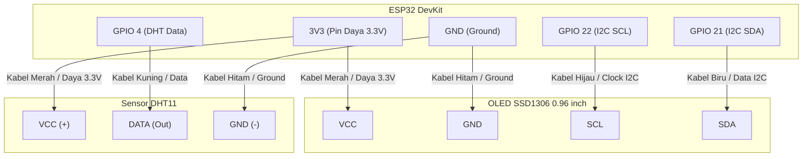

# PANDUAN LENGKAP IMPLEMENTASI: ESP32 ASYNC WEB DASHBOARD (DHT11 + OLED SSD1306 + SPIFFS/LITTLEFS)

Dokumen ini memuat panduan komprehensif mulai dari **bedah arsitektur kode**, **dasar teori sistem file flash (SPIFFS & LittleFS)**, **persiapan tools & library**, **skema perkabelan (wiring diagram)**, hingga **langkah pengerjaan tahap-demi-tahap** beserta solusi kendala (*troubleshooting*).

---

## DAFTAR ISI
1. [Bedah Skrip dan Arsitektur Proyek](#1-bedah-skrip-dan-arsitektur-proyek)
2. [Dasar Teori Flash File System (SPIFFS vs LittleFS)](#2-dasar-teori-flash-file-system-spiffs-vs-littlefs)
3. [Daftar Kebutuhan Komponen & Wiring Diagram](#3-daftar-kebutuhan-komponen--wiring-diagram)
4. [Persiapan Software, Plugin, dan Library](#4-persiapan-software-plugin-dan-library)
5. [Langkah Pengerjaan Tahap demi Tahap](#5-langkah-pengerjaan-tahap-demi-tahap)
6. [Pengujian dan Monitoring](#6-pengujian-dan-monitoring)
7. [Panduan Troubleshooting & Tips](#7-panduan-troubleshooting--tips)

---

## 1. BEDAH SKRIP DAN ARSITEKTUR PROYEK

Proyek ini dibangun secara modular untuk memisahkan logika antarmuka web, pembacaan sensor, tampilan fisik OLED, koneksi WiFi, dan penanganan HTTP request.

```
04-DHT11-Web-Dashboard/
├── 04-DHT11-Web-Dashboard.ino   # Program utama (setup & loop non-blocking)
├── config.h                     # Konfigurasi pinout, kredensial WiFi, & konstanta
├── dht_sensor.h                 # Driver pembacaan sensor DHT11
├── oled_display.h               # Driver tampilan layar OLED SSD1306 (I2C)
├── wifi_manager.h               # Pengelola koneksi WiFi (STA Mode)
├── async_server.h               # Server web asinkron & penyaji REST API (/api/now)
└── data/                        # Folder flash file system (di-upload ke SPIFFS/LittleFS)
    ├── index.html               # Frontend dashboard (HTML + Polling JavaScript)
    └── style.css                # Styling modern Dark Glassmorphism
```

### Rincian Fungsi Tiap File:
1. **`config.h`**:
   - Berisi definisi pin: `DHT_PIN 4`, `OLED_SDA 21`, `OLED_SCL 22`.
   - Konfigurasi alamat I2C OLED `0x3C`, dimensi layar `128x64`.
   - Kredensial jaringan: `WIFI_SSID` dan `WIFI_PASS`.
   - Periode sampling sensor: `SENSOR_READ_INTERVAL 2000` (2 detik).

2. **`dht_sensor.h`**:
   - Memanfaatkan library Adafruit DHT.
   - Fungsi `initDHT()` untuk memulai driver sensor.
   - Fungsi `readDHT(float &temp, float &hum)` memvalidasi dengan `isnan()` untuk mencegah pengiriman data korup (*NaN*).

3. **`oled_display.h`**:
   - Mengendalikan layar OLED SSD1306 melalui komunikasi I2C (Wire).
   - `showConnectingWiFi()` menampilkan visual saat ESP32 sedang *handshake* ke router.
   - `drawDashboardOled()` merender *dashboard mini* 2 kolom (Suhu & Kelembapan), status ONLINE/OFFLINE, serta IP Address lokal.

4. **`wifi_manager.h`**:
   - Menghubungkan ESP32 ke Access Point dalam mode *Station* (`WIFI_STA`).
   - Melakukan perulangan hingga 40 kali percobaan (timeout 20 detik).
   - Menyimpan status koneksi `wifiConnected` dan alamat IP `localIPAddress`.

5. **`async_server.h`**:
   - Menggunakan `ESPAsyncWebServer` dan `LittleFS` (atau `SPIFFS`).
   - `initLittleFS()` melakukan *mount* file system flash.
   - `serveStatic("/", LittleFS, "/").setDefaultFile("index.html")`: Menjadikan file `index.html` dan `style.css` disajikan otomatis layaknya web server profesional.
   - Endpoint `GET /api/now`: Membungkus data terkini (Suhu, Humiditas, RSSI sinyal, Uptime, IP, SSID) ke dalam format JSON menggunakan `ArduinoJson v7` (`JsonDocument`).

6. **`04-DHT11-Web-Dashboard.ino`**:
   - File *entry-point*.
   - Pada `setup()`: menginisialisasi Serial, OLED, DHT, File System, WiFi, dan Web Server secara berurutan.
   - Pada `loop()`: Menggunakan teknik `millis()` *non-blocking* setiap 2 detik untuk membaca sensor dan memperbarui OLED fisik.
   - **Catatan Penting**: Tidak ada `server.handleClient()` di dalam `loop()`, karena `ESPAsyncWebServer` berjalan pada *background task* (FreeRTOS core) ESP32.

7. **`data/index.html` & `data/style.css`**:
   - Frontend modern dengan tema *Dark Glassmorphism* (efek kaca transparan dan blur latar belakang).
   - JavaScript di dalam HTML mengeksekusi `fetch('/api/now')` secara berkala setiap 2 detik.
   - Status badge otomatis berubah hijau (**ONLINE**) saat API merespons, dan merah (**OFFLINE**) jika koneksi terputus.

---

## 2. DASAR TEORI FLASH FILE SYSTEM (SPIFFS vs LITTLEFS)

### 2.1 Mengapa Memerlukan Flash File System pada ESP32?
Secara umum di Arduino/ESP, programmer pemula sering menyematkan kode HTML dan CSS langsung ke dalam string C++ di memori program (PROGMEM), contohnya:
```cpp
// CARA LAMA (Kurang Efisien):
const char index_html[] PROGMEM = "<html><body><h1>Suhu: ...</h1></body></html>";
```
Kelemahan cara lama:
- Menghabiskan ruang partisi kode program (*Flash Program Memory*).
- Kode program menjadi sangat panjang dan sulit dibaca/di-maintain.
- Desain antarmuka (HTML/CSS/JS) tidak bisa diuji secara terpisah di browser komputer.
- Tidak mendukung fitur *browser caching* file statis secara optimal.

**Solusinya adalah Flash File System**:
Memori internal flash ESP32 (umumnya berukuran 4 MB) dibagi menjadi beberapa partisi:
1. **Bootloader & Partition Table** (~64 KB)
2. **App / Firmware Partition** (Tempat sketch `.bin` Anda berjalan)
3. **OTA Partition** (Untuk pembaruan firmware over-the-air)
4. **Filesystem Partition (SPIFFS/LittleFS)** (Tempat penyimpanan file seperti flashdisk kecil)

Dengan File System, seluruh file web statis (`index.html`, `style.css`, gambar, font, script) diletakkan di dalam folder `data/` dan diunggah ke partisi memori flash khusus ini. ESP32 kemudian menyajikan file-file ini langsung via HTTP.

### 2.2 Perbandingan SPIFFS vs LittleFS
| Parameter | SPIFFS (SPI Flash File System) | LittleFS (Little File System) |
| :--- | :--- | :--- |
| **Status Dukungan** | Legacy / Usang (*Deprecated* pada ESP-IDF v5+) | Standar Modern Resmi Espressif |
| **Dukungan Direktori** | Struktur Flat (simulasi direktori dengan nama `/dir/file`) | Direktori Riil (*Real Tree Directory*) |
| **Performa & Kecepatan** | Cenderung melambat jika kapasitas flash hampir penuh | Cepat, efisien dalam alokasi blok |
| **Konsumsi RAM** | Membutuhkan RAM lebih besar untuk traversal file | Sangat hemat RAM (*Low Footprint*) |
| **Ketahanan Daya (*Power-Loss Resilience*)** | Rentan korupsi jika daya mati saat penulisan file | Tahan korupsi (desain *Copy-on-Write*) |
| **Wear Leveling** | Dasar | Algoritma *Dynamic Wear Leveling* lebih canggih |

> **Catatan Implementasi pada Proyek Ini**:
> Skrip bawaan proyek (`async_server.h`) telah menggunakan **LittleFS** karena lebih stabil dan modern. Namun secara alur kerja (*workflow*), penggunaan **SPIFFS** dan **LittleFS** identik: keduanya membaca folder `data/` dan memerlukan plugin uploader di Arduino IDE.
> 
> *Jika Anda diwajibkan menggunakan SPIFFS murni*, Anda hanya perlu mengubah baris di `async_server.h`:
> ```cpp
> // Opsi SPIFFS murni:
> #include <SPIFFS.h>
> inline bool initLittleFS() {
>   if (!SPIFFS.begin(true)) return false;
>   return true;
> }
> // dan pada routing:
> asyncServer.serveStatic("/", SPIFFS, "/").setDefaultFile("index.html");
> ```

---

## 3. DAFTAR KEBUTUHAN KOMPONEN & WIRING DIAGRAM

### 3.1 Daftar Komponen Hardware
1. **1x ESP32 NodeMCU / DevKit V1** (30-pin atau 38-pin).
2. **1x Sensor DHT11** (Modul 3-pin dengan resistor pull-up bawaan, atau sensor 4-pin mandiri + resistor 10kΩ).
3. **1x Layar OLED 0.96 inch I2C SSD1306** (128x64 piksel, 4-pin).
4. **1x Breadboard** (830 atau 400 titik).
5. **Kabel Jumper DuPont** (Male-to-Male atau Male-to-Female sesuai kebutuhan).
6. **1x Kabel Micro USB / USB-C** untuk data dan daya.

### 3.2 Tabel Koneksi Pin (Wiring Pinout)

| Komponen | Pin Sensor / Layar | Pin ESP32 (GPIO) | Keterangan / Fungsi |
| :--- | :--- | :--- | :--- |
| **Sensor DHT11** | **VCC (+) / Pin 1** | **3V3 (atau 5V)** | Sumber daya tegangan logika 3.3V |
| | **DATA / OUT / Pin 2** | **GPIO 4** | Sinyal data digital 1-Wire |
| | **GND (-) / Pin 4** | **GND** | Ground bersama |
| | *(Catatan: jika pakai sensor 4-pin, pasang resistor 10kΩ antara VCC & DATA)* | | |
| **Layar OLED I2C** | **VCC** | **3V3** | Sumber daya 3.3V |
| | **GND** | **GND** | Ground |
| | **SCL (Clock)** | **GPIO 22** | Jalur I2C Serial Clock |
| | **SDA (Data)** | **GPIO 21** | Jalur I2C Serial Data |

### 3.3 Skema Rangkaian Wiring



---

## 4. PERSIAPAN SOFTWARE, PLUGIN, DAN LIBRARY

### 4.1 Instalasi Board Package ESP32 pada Arduino IDE
1. Buka Arduino IDE.
2. Masuk ke menu **File** > **Preferences**.
3. Pada kolom **Additional Boards Manager URLs**, tambahkan URL resmi Espressif:
   ```
   https://raw.githubusercontent.com/espressif/arduino-esp32/gh-pages/package_esp32_index.json
   ```
4. Buka menu **Tools** > **Board** > **Boards Manager...**, cari kata kunci `esp32` oleh **Espressif Systems**, lalu klik **Install**.

---

### 4.2 Download & Install Plugin File System Uploader

Agar file di folder `data/` dapat di-flash ke memori ESP32, Anda memerlukan plugin uploader. Pilih sesuai versi Arduino IDE yang Anda gunakan:

#### A. Jika Menggunakan Arduino IDE 1.8.x (Legacy)
1. **Untuk SPIFFS**:
   - Download file rilis `ESP32FS-1.0.zip` dari GitHub resmi:
     `https://github.com/me-no-dev/arduino-esp32fs-plugin/releases`
   - Buka folder sketchbook Arduino Anda (biasanya `C:\Users\<NamaAnda>\Documents\Arduino`).
   - Buat folder baru bernama `tools` jika belum ada.
   - Ekstrak zip ke dalam folder tersebut hingga strukturnya menjadi:
     `Documents/Arduino/tools/ESP32FS/tool/esp32fs.jar`
   - Restart Arduino IDE. Menu **Tools** > **ESP32 Sketch Data Upload** akan muncul.
2. **Untuk LittleFS** (Sangat disarankan untuk sketch ini):
   - Download file `arduino-esp32-littlefs-plugin.zip` dari:
     `https://github.com/lorol/arduino-esp32-littlefs-plugin/releases`
   - Ekstrak ke `Documents/Arduino/tools/ESP32LittleFS/tool/esp32littlefs.jar`.
   - Restart Arduino IDE. Menu **Tools** > **ESP32 LittleFS Data Upload** akan muncul.

Refersensi Alternantif : 
   - https://randomnerdtutorials.com/esp32-write-data-littlefs-arduino/
   - https://randomnerdtutorials.com/esp32-vs-code-platformio-spiffs/
   - https://randomnerdtutorials.com/esp8266-web-server-spiffs-nodemcu/

#### B. Jika Menggunakan Arduino IDE 2.x (Modern)
Arduino IDE 2.x menggunakan arsitektur berbasis Electron/VSCode.
1. Download plugin installer terbaru:
   - Kunjungi: `https://github.com/earlephilhower/arduino-littlefs-upload/releases`
   - Atau `https://github.com/Jason-C-Daniels/arduino-spiffs-esp32/releases`
2. Download file berekstensi `.vsix` (misal `arduino-littlefs-upload-x.x.x.vsix`).
3. Buat folder `plugins` di direktori konfigurasi IDE 2:
   - Path Windows: `C:\Users\<NamaAnda>\.arduinoIDE\plugins\`
4. Letakkan file plugin di folder tersebut.
5. Buka Arduino IDE 2, tekan `Ctrl + Shift + P` pada keyboard untuk membuka *Command Palette*, lalu ketik:
   `Upload LittleFS to Pico/ESP8266/ESP32` atau `Upload SPIFFS`.

---

### 4.3 Instalasi Library Arduino Wajib

Buka Arduino IDE, masuk ke menu **Sketch** > **Include Library** > **Manage Libraries...** (`Ctrl + Shift + I`), lalu cari dan install library berikut:

1. **`ESPAsyncWebServer`** by *me-no-dev* / *Mathieu Carbou*
   - *Rekomendasi Modern*: Cari `ESPAsyncWebServer` by **Mathieu Carbou** (kompatibel penuh dengan ESP32 Core v2.x dan v3.x).
2. **`AsyncTCP`** by *me-no-dev* / *Mathieu Carbou*
   - Wajib diinstal sebagai fondasi jaringan asinkron untuk ESPAsyncWebServer.
3. **`ArduinoJson`** by *Benoit Blanchon*
   - Install **Versi 7.x** (karena `async_server.h` menggunakan sintaks modern `JsonDocument doc;`).
4. **`Adafruit SSD1306`** by *Adafruit*
   - Library untuk layar OLED 0.96 inch.
5. **`Adafruit GFX Library`** by *Adafruit*
   - Grafis inti untuk OLED (otomatis diminta saat install SSD1306).
6. **`DHT sensor library`** by *Adafruit*
   - Driver untuk sensor DHT11/DHT22.
7. **`Adafruit Unified Sensor`** by *Adafruit*
   - Dependensi pendukung sensor DHT.

---

## 5. LANGKAH PENGERJAAN TAHAP DEMI TAHAP

### Langkah 1: Merakit Rangkaian Fisik
1. Pastikan kabel USB belum terhubung ke komputer (keadaan mati / *unpowered*).
2. Pasang ESP32 di tengah breadboard.
3. Hubungkan pin VCC OLED dan DHT11 ke rail 3.3V ESP32.
4. Hubungkan pin GND OLED dan DHT11 ke rail GND ESP32.
5. Hubungkan pin **DATA DHT11** ke **GPIO 4**.
6. Hubungkan pin **SDA OLED** ke **GPIO 21** dan **SCL OLED** ke **GPIO 22**.
7. Periksa kembali dengan teliti jangan sampai pin VCC dan GND tertukar untuk mencegah korsleting.

---

### Langkah 2: Menyiapkan File dan Struktur Folder
Pastikan file tersusun rapi di dalam folder sketch utama. Struktur harus seperti ini:
```
04-DHT11-Web-Dashboard/
  ├── 04-DHT11-Web-Dashboard.ino
  ├── config.h
  ├── dht_sensor.h
  ├── oled_display.h
  ├── wifi_manager.h
  ├── async_server.h
  └── data/
        ├── index.html
        └── style.css
```
> [!IMPORTANT]
> Folder `data/` wajib berada tepat di dalam folder sketch yang sama dengan file `.ino`. Jika berada di luar atau salah ketik nama, uploader file system tidak akan menemukan aset web!

---

### Langkah 3: Mengatur Kredensial WiFi
Buka file `config.h`, lalu ubah konstanta baris 14 dan 15 sesuai jaringan WiFi di lokasi Anda (Gunakan frekuensi WiFi 2.4 GHz, karena ESP32 tidak mendukung 5 GHz):
```cpp
// ---------------- KREDENSIAL WI-FI ----------------
#define WIFI_SSID       "Nama_WiFi_Rumah_Anda"
#define WIFI_PASS       "Password_WiFi_Anda"
```

---

### Langkah 4: Upload File Web Assets ke SPIFFS / LittleFS
Proses ini mentransfer file `index.html` dan `style.css` ke memori flash ESP32.

1. Hubungkan ESP32 ke komputer melalui kabel data USB.
2. Di Arduino IDE, pilih Board: **Tools** > **Board** > **ESP32 Arduino** > **ESP32 Dev Module** (atau sesuai modul Anda).
3. Pilih port COM yang sesuai di **Tools** > **Port** (misal COM3, COM5).
4. **PENTING**: **TUTUP SERIAL MONITOR**. Jika Serial Monitor terbuka, port COM akan sibuk (*busy*) dan proses upload file system akan gagal.
5. Eksekusi Upload Data:
   - **Pada Arduino IDE 1.8.x**: Klik menu **Tools** > **ESP32 LittleFS Data Upload** (atau **ESP32 Sketch Data Upload** jika menggunakan SPIFFS).
   - **Pada Arduino IDE 2.x**: Tekan `Ctrl + Shift + P`, pilih `Upload LittleFS to Pico/ESP8266/ESP32`.
6. Tunggu hingga terminal Arduino menampilkan pesan:
   ```
   [LittleFS] upload  : /index.html ...
   [LittleFS] upload  : /style.css ...
   Completed LittleFS Image!
   ```

---

### Langkah 5: Kompilasi dan Flash Firmware Sketch Utama
Setelah file HTML & CSS berhasil diunggah ke flash:
1. Buka file utama `04-DHT11-Web-Dashboard.ino`.
2. Klik tombol **Verify** (ikon centang) untuk memastikan tidak ada kesalahan kompilasi.
3. Klik tombol **Upload** (ikon panah kanan) untuk mem-flash kode firmware ke ESP32.
4. *Catatan*: Jika proses upload macet di tulisan `Connecting........_____.....`, tekan dan tahan tombol **BOOT** pada modul ESP32 selama 2 detik hingga persentase upload mulai berjalan, lalu lepaskan.

---

## 6. PENGUJIAN DAN MONITORING

### 6.1 Memeriksa Serial Monitor
1. Buka Serial Monitor di Arduino IDE (**Tools** > **Serial Monitor**).
2. Atur baud rate di pojok kanan bawah ke **115200 baud**.
3. Tekan tombol **EN / RST** pada board ESP32 untuk me-restart mikrokontroler.
4. Perhatikan log yang muncul:
   ```
   =================================================
      PROYEK 4: DHT11 ASYNC WEB DASHBOARD (LITTLEFS) 
   =================================================
   [DHT11] Driver sensor berhasil diinisialisasi pada GPIO 4
   [LittleFS] File system berhasil dimuat.
   [WIFI] Menghubungkan ke: Nama_WiFi_Anda
   ......
   [WIFI] Berhasil terhubung!
   [WIFI] Alamat Dashboard: http://192.168.1.15
   [ASYNC HTTP] Server aktif dan siap melayani request di background.
   [ASYNC NODE] Suhu: 28.4 °C | Hum: 65.0 %
   ```

### 6.2 Memeriksa Layar Fisik OLED
- Sesaat setelah boot, OLED akan menampilkan: `"MENYAMBUNG WI-FI..."` beserta nama SSID.
- Setelah terhubung, OLED akan berubah menjadi tampilan Dashboard:
  - Header: `ASYNC DASHBOARD: ON`
  - Baris IP: `IP: 192.168.x.x`
  - Kolom Kiri: Angka Suhu (misal `28.4C`)
  - Kolom Kanan: Angka Kelembapan (misal `65%`)

### 6.3 Mengakses Web Dashboard di Browser
1. Pastikan laptop atau smartphone Anda terhubung ke **jaringan WiFi yang sama** dengan ESP32.
2. Buka browser (Google Chrome, Firefox, Safari, atau Edge).
3. Ketik alamat IP ESP32 yang tertera di Serial Monitor atau OLED pada *address bar*, contoh:
   ```
   http://192.168.1.15
   ```
4. Dashboard bertema *Dark Glassmorphism* akan muncul seketika:
   - Badge status di pojok kanan atas berkedip hijau bertuliskan **ONLINE**.
   - Metrik *Ambient Temperature* dan *Relative Humidity* diperbarui otomatis setiap 2 detik tanpa perlu me-refresh halaman browser.
   - Tabel *Hardware & Network Telemetry* menampilkan RSSI sinyal, Uptime perangkat, dan waktu polling terakhir.
5. Anda juga dapat menguji respons REST API mentah secara langsung dengan membuka URL:
   ```
   http://192.168.1.15/api/now
   ```
   Browser akan menampilkan data JSON murni:
   ```json
   {"temp":28.4,"hum":65.0,"online":true,"rssi":-58,"uptime":142,"ip":"192.168.1.15","ssid":"Nama_WiFi_Anda"}
   ```

---

## 7. PANDUAN TROUBLESHOOTING & TIPS

### 1. Muncul Tulisan `[LittleFS ERROR] Gagal mount file system flash!`
- **Penyebab**: Partisi LittleFS/SPIFFS belum pernah di-format atau file data belum di-upload.
- **Solusi**: Di kode `async_server.h`, baris `LittleFS.begin(true)` memiliki parameter `true` yang berarti akan otomatis memformat flash jika gagal mount pertama kali. Jika tetap gagal, pastikan Anda telah menjalankan menu **ESP32 Data Upload** dengan benar saat Serial Monitor tertutup.

### 2. Layar Browser Menampilkan `404: Not Found`
- **Penyebab**: File `index.html` belum ter-upload ke folder SPIFFS/LittleFS di ESP32.
- **Solusi**: Pastikan file `index.html` dan `style.css` berada di dalam folder bernama `data` (huruf kecil semua) di lokasi sketch, lalu lakukan upload data kembali melalui plugin IDE.

### 3. Nilai Sensor Menampilkan `nan` atau `--` di Web & OLED
- **Penyebab**: ESP32 tidak menerima pulsa data dari sensor DHT11.
- **Solusi**:
  - Periksa kabel pada GPIO 4. Pastikan kabel jumper tidak longgar.
  - Jika menggunakan sensor DHT11 telanjang 4-pin, pastikan resistor pull-up 10kΩ terpasang antara pin VCC dan pin Data.
  - Pastikan pin VCC DHT11 terhubung ke 3.3V (atau ke 5V/VIN jika menggunakan modul dengan regulator bawaan).

### 4. Layar OLED Hitam / Tidak Menyala
- **Penyebab**: Pengkabelan I2C longgar atau alamat I2C salah.
- **Solusi**:
  - Periksa koneksi: SDA harus ke GPIO 21, SCL harus ke GPIO 22.
  - Sebagian modul OLED SSD1306 menggunakan alamat I2C `0x3D` bukan `0x3C`. Cek di `config.h` pada `#define OLED_I2C_ADDR 0x3C`. Jalankan program *I2C Scanner* jika alamat tidak diketahui.

### 5. Error Kompilasi Terkait `JsonDocument`
- **Penyebab**: Menggunakan ArduinoJson versi lama (v5 atau v6).
- **Solusi**: Sintaks `JsonDocument doc;` adalah standar dari **ArduinoJson versi 7.x**. Buka Library Manager dan perbarui `ArduinoJson` ke versi 7.x terbaru.

### 6. Laptop / HP Tidak Bisa Membuka Dashboard Web
- **Penyebab**: Perangkat pengakses berada di subnet jaringan yang berbeda atau router menerapkan *Client Isolation* (*AP Isolation*).
- **Solusi**: Pastikan laptop/HP terhubung ke WiFi router/hotspot yang persis sama dengan ESP32. Hindari menggunakan koneksi *Guest WiFi* yang memblokir komunikasi antar perangkat lokal.

---
*Panduan ini disusun untuk proyek firmware IoT: 04-DHT11-Web-Dashboard.*
